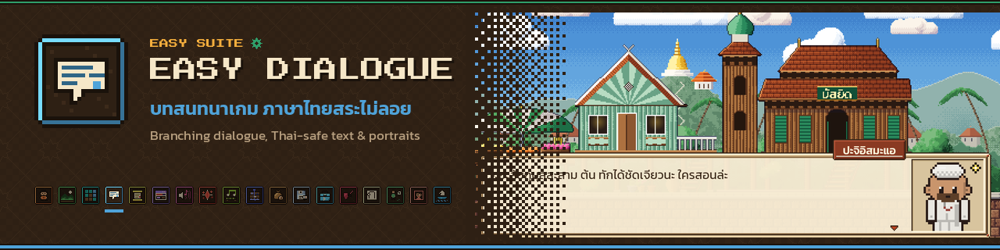
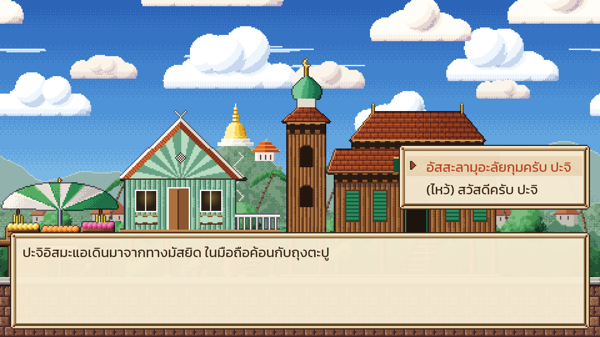
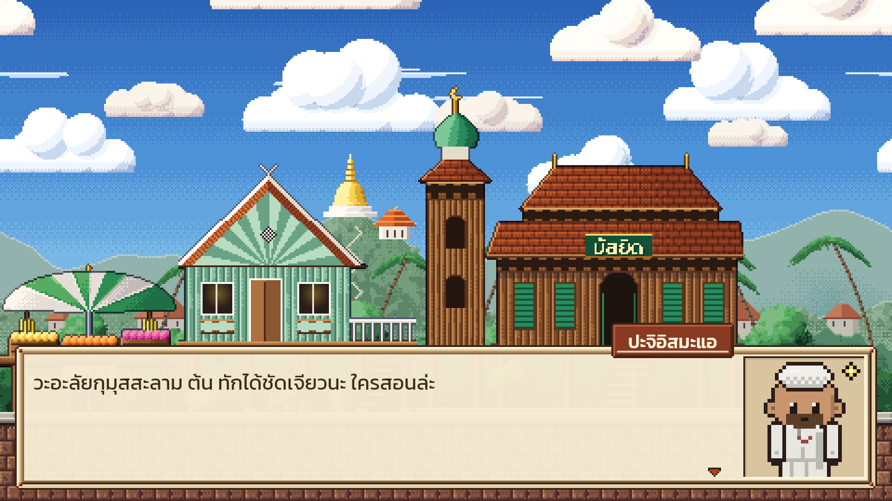
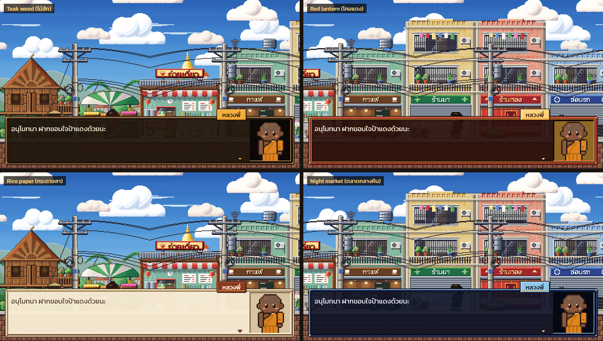
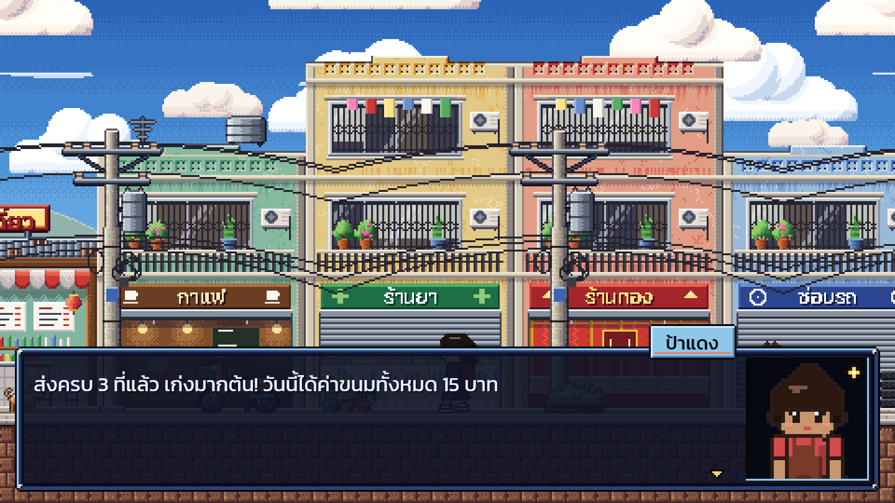

<!-- easy-suite:header:start -->
<p align="center">
  <a href="#easy-suite"></a>
</p>

<p align="center">
  <b>Easy Dialogue</b> · บทสนทนาเกม ภาษาไทยสระไม่ลอย · Branching dialogue, Thai-safe text & portraits<br />
  <sub>Part of <a href="#easy-suite"><b>Easy Suite</b></a>: Thai-friendly pixel-art game dev tools for Godot 4.3+ and PixiJS v8</sub>
</p>

<p align="center">
  <a href="https://github.com/Saladin2020/easydialogue/actions/workflows/ci.yml"></a> <a href="LICENSE"></a>  <a href="#export"></a> <a href="docs/MCP.md"></a> 
</p>

<p align="center">
  <a href="https://github.com/Saladin2020/easysprite"></a>
  <a href="https://github.com/Saladin2020/easyscene"></a>
  <a href="https://github.com/Saladin2020/easytilemap"></a>
  <a href="https://github.com/Saladin2020/easydialogue"></a>
  <a href="https://github.com/Saladin2020/easyquest"></a>
  <a href="https://github.com/Saladin2020/easyui"></a>
  <a href="https://github.com/Saladin2020/easysfx"></a>
  <a href="https://github.com/Saladin2020/easyfx"></a>
  <a href="https://github.com/Saladin2020/easymusic"></a>
  <a href="https://github.com/Saladin2020/easyanim"></a>
  <a href="https://github.com/Saladin2020/easyitems"></a>
  <a href="https://github.com/Saladin2020/easysave"></a>
  <a href="https://github.com/Saladin2020/easykit"></a>
  <a href="https://github.com/Saladin2020/easybattle"></a>
  <a href="https://github.com/Saladin2020/easyfont"></a>
  <a href="https://github.com/Saladin2020/easynpc"></a>
  <a href="https://github.com/Saladin2020/easyportrait"></a>
  <a href="https://github.com/Saladin2020/easyship"></a>
</p>
<!-- easy-suite:header:end -->

# Easy Dialogue

**บทสนทนาเกม · ตัวเลือก · ตัวแปร · ภาษาไทยสระไม่ลอย**  
Write branching game dialogue as plain text (`.ezd`), see it play in a pixel dialogue box with Easy Sprite
portraits, and export it to **Godot 4.3+**, **PixiJS v8** or JSON — with Thai text that wraps on word
boundaries and never drops a vowel or tone mark. The third sibling of
[Easy Sprite](https://github.com/Saladin2020/easysprite) (characters) and
[Easy Scene](https://github.com/Saladin2020/easyscene) (levels).

[](https://nodejs.org)

> Easy Dialogue **writes · checks · plays · renders · exports**. No AI generation in-app, and it never calls
> a TTS API — the voice export is a manifest you can feed to ElevenLabs yourself.

<p align="center">
  
</p>

<p align="center">
  
  
</p>

---

## What you get

| Script | Box | Portraits | Export |
| --- | --- | --- | --- |
| `.ezd` text: characters, nodes, choices with conditions, `if/elif/else`, variables, `{interpolation}`, events, line ids — errors with **line numbers** and "did you mean" | 9-slice pixel frames in 4 styles (teak · lantern · paper · night), name plate in the character colour, typewriter by grapheme cluster, choice list with cursor, next arrow | 32×32 crops from Easy Sprite sheets ×2, 7 emotions (generic faces re-composed with Easy Sprite where possible; lashes/elder/glasses and other non-generic faces get procedural eye/mouth variants so those features stay; plus pixel overlays) | Godot 4.3+ project (runner + `DialogueBox.tscn`), PixiJS v8 runtime + demo page, compiled JSON, voice manifest (JSON + CSV) |

* **Thai first.** Kanit (OFL) is bundled and used everywhere: Skia/HarfBuzz for PNG previews, the browser,
  Pixi and Godot. Lines wrap with `Intl.Segmenter` (ICU word-smart autowrap in Godot) so Thai needs no spaces,
  and the typewriter reveals whole clusters (`น้ำ`, `ที่`, `ผู้`) instead of floating marks.
* **One runner, three places.** The same JS runner drives the CLI, the editor, the tests and the Pixi
  export; the GDScript runner mirrors it, and a test compares their transcripts.
* **Agent friendly.** CLI with `--json`, an HTTP API and an MCP server (stdio + HTTP) with 7 tools.

<p align="center">
  
</p>

### Multicultural village demo · สลามเพื่อนบ้าน

`salam_neighbours.ezd` takes place in a southern Thai town where Buddhist, Muslim and Chinese-Thai families
live side by side. After a storm, ต้น (a Buddhist boy) and his friend อาดัม (a Muslim boy in a kopiah) help
fix the roof of the Tadika school (ตาดีกา) next to the mosque, then carry chairs into the temple sala for the
evening merit-making. Along the way ต้น learns to greet with **อัสสะลามุอะลัยกุม**, and the answer is
**วะอะลัยกุมุสสะลาม**. He also learns what **อินชาอัลลอฮ์** means ("if Allah wills", said about plans for
later) and how to say **ขอบคุณ** in Malay (ตรีมอกาเซะ). The story ends with roti and teh tarik at ก๊ะนะ's tea
shop and an invitation to wrap ketupat (ตูปะ) for Hari Raya (รายอ). Both greetings, the salam and the wai,
are offered as choices and both are welcomed. The cast adds five Muslim neighbours made from Easy Sprite:
ก๊ะฟาตีมะห์ (hijab teacher), อาดัม (kopiah boy), ปะจิอิสมะแอ (jubah + kopiah, beard), ก๊ะนะ (roti seller)
and ไอชะฮ์ (Tadika girl in a white school tudung). The background is Easy Scene's `harmony_town`, and the
`@camera` targets (`market`, `tadika`, `temple`) are spawns in Easy Tilemap's `multicultural_village`.

<p align="center">
  
  
</p>

```bash
easydialogue play salam_neighbours --picks 0,0,0,0 --vars
```

<p align="center">
  
</p>

## Quick start

```bash
npm install
npx tsx src/cli.ts init --workspace ./my-dialogue      # demo scripts (village_delivery, salam_neighbours), cast portraits, backgrounds
npx tsx src/cli.ts serve --workspace ./my-dialogue     # editor → http://127.0.0.1:8798/
```

Dev mode: `npm run dev` (API on 8798) + `npx vite --config web/vite.config.ts` (UI on 5175).

The editor: script with syntax highlighting and an error gutter (`Ctrl+S` saves; drafts with errors are kept but cannot be exported), live play
preview (click / Enter / Space, ↑↓ or 1-9 for choices, typewriter speed, box style, background, start node),
story graph (click a node to jump), variables + transcript, export buttons and the cast list.

## Script in 20 lines

```ezd
@title ต้นส่งของรอบหมู่บ้าน
@var coins = 0
@char kid    "ต้น"    portrait=town_kid    color=#f4ae3d voice=th_boy
@char vendor "ป้าแดง" portrait=town_vendor color=#e5806c side=right voice=th_auntie

=== market
> เช้าวันเสาร์ ตลาดหน้าหมู่บ้านคึกคัก
vendor [happy]: ต้นจ๋า ช่วยป้าส่งของหน่อยได้ไหม
* ได้เลยครับ!
    ~ coins += 10
    -> temple
* [if coins >= 5] ซื้อขนมก่อน -> END
* ไม่ว่างครับ -> END

=== temple
kid [ดีใจ]: ได้ค่าขนม {coins} บาทแล้ว
@sfx fanfare
```

Full reference: **[docs/SCRIPT_FORMAT.md](docs/SCRIPT_FORMAT.md)** (headers, statements, expressions,
diagnostics and the compiled `easydialogue/1` JSON).

## CLI

```bash
easydialogue check village_delivery            # file:line:col errors / warnings; exit 1 on errors (--strict, --json)
easydialogue play village_delivery             # interactive in the terminal
easydialogue play village_delivery --picks 0,0 --vars
easydialogue render village_delivery --choice 1 --selected 1 --out choices.png   # 1440×810 (--scale 3)
easydialogue render village_delivery --line 4 --style night --reveal 0.5 --out typing.png
easydialogue portraits --sheet path/to/hero.png --id hero       # Easy Sprite sheet (+ .json) → portraits/hero/<emotion>.png
easydialogue export village_delivery --preset all        # json | pixi | godot | voice | all
easydialogue compile village_delivery --out village.json
easydialogue list · info · portraits-list · serve [--port 8798]
```

(`npx tsx src/cli.ts …` from a checkout, `node dist/cli.js …` after `npm run build`.)

## Export

| Preset | Output (`exports/<id>-<preset>/`) |
| --- | --- |
| `json` | `<id>.dialogue.json` — compiled `easydialogue/1` |
| `pixi` | bundle JSON (doc + layout + asset paths), `easydialogue-runner.js`, `easydialogue-pixi.js` (`loadDialogue`, `DialogueBox`), frames, used portraits, Kanit, background and a playable `index.html` |
| `godot` | Godot 4.3+ project: `addons/easydialogue/` (`dialogue_runner.gd`, `dialogue_box.gd`, `dialogue_box.tscn`), demo `main.tscn`, `test_runner.gd`, 480×270 viewport, nearest filter, integer scale |
| `voice` | `<id>.voice.json` + `.voice.csv`: every line with id, speaker, character `voice=` id, emotion, text, suggested file — **manifest only** |

**PixiJS v8**

```js
import { loadDialogue, DialogueBox } from "./easydialogue-pixi.js";
const bundle = await loadDialogue(PIXI, "./village_delivery.dialogue.json");
const box = new DialogueBox(PIXI, bundle, { onEvent: (name, args) => {}, onEnd: (vars) => {} });
app.stage.addChild(box.view);
app.ticker.add((t) => box.update(t.deltaMS / 1000));
box.bindKeys(window, app.canvas);
box.start();
```

Drop `pixi.min.js` next to `index.html` to run offline; otherwise it loads PixiJS 8 from jsDelivr.

**Godot 4.3+** — open the exported folder and press F5, or copy `addons/easydialogue`, `fonts/`, `frames/`,
`portraits/` and `dialogue/` into your project, instance `dialogue_box.tscn` in a `CanvasLayer` and set
`dialogue_path`. Signals: `line_started(ev)`, `choice_made(option)`, `event_fired(name, args)`,
`dialogue_finished(vars)`. Headless check: `godot --headless --path . --script res://test_runner.gd -- picks=0,0`.

<p align="center">
  
  
</p>

## Portraits from Easy Sprite

`easydialogue portraits --sheet sheet.png` reads the front idle frame of an Easy Sprite native sheet, centres a
32×32 crop on the eyes and writes `neutral happy sad surprised angry thinking shy`. When the sheet's `.json`
has its project selections and the Easy Sprite CLI is available (`EASYDIALOGUE_EASYSPRITE_CLI`), generic faces
are re-composed (`face_smile` for happy, `face_blink` for thinking, `face_frown` / `face_surprise` / `face_wink`
when those parts exist). Non-generic faces (lashes, elder, glasses, beard…) keep their features and get
procedural per-emotion eye/mouth variants instead of a whole-face swap. Every emotion also gets a small pixel
overlay. Failed-condition choices default to hidden; `@choices grey` (or a per-choice `[grey]` / `#grey`) shows
them greyed out and unselectable. Use any other 32px+ PNGs by dropping them in `portraits/<set>/<emotion>.png`.

## MCP

`npm run mcp` (stdio) or `npm run mcp:http` (`http://127.0.0.1:8799/mcp`). Tools: `workspace_info`,
`list_dialogues`, `get_dialogue`, `write_dialogue`, `make_portraits`, `render_preview`, `export_dialogue`.
See **[docs/MCP.md](docs/MCP.md)**.

## Security

The server binds to `127.0.0.1` by default and rejects cross-origin writes and non-loopback `Host` headers.
`--host 0.0.0.0` requires the token printed at startup (or `EASYDIALOGUE_TOKEN`). API and MCP paths stay
inside the workspace plus `EASYDIALOGUE_ALLOWED_DIRS`.

## Development

```bash
npm run typecheck && npm test && npm run build && npm run smoke
GODOT=/path/to/godot npx vitest run test/godot.test.ts   # GDScript ↔ JS runner parity
npm run docs:images                                      # README images from the samples
python3 scripts/check-pixi.py exports/village_delivery-pixi   # headless Chrome: Pixi export, no console errors
python3 scripts/capture-ui.py                           # editor screenshot (server on :8798)
```

Ports: API / editor 8798 · MCP HTTP 8799 · Vite 5175.

<!-- easy-suite:table:start -->
## Easy Suite


Eighteen small, local-first tools that share one look (teak, lantern gold, Kanit, 16/48px pixels), one
workflow (CLI · web editor · MCP server) and the same targets (**Godot 4.3+** and **PixiJS v8**).
ชุดเครื่องมือทำเกมพิกเซลสไตล์ไทย ใช้ร่วมกันได้ทั้งชุด · **Easy Kit** builds a whole playable game from the others and
**Easy Ship** packages it for the web, desktop and Android.  
The samples share one multicultural southern Thai village: Buddhist temple, wooden kampung mosque and
Chinese-Thai shrine on the same street. หมู่บ้านพหุวัฒนธรรม วัด มัสยิด ศาลเจ้า อยู่ร่วมกันในเมืองเดียว

| | Tool | What it does | Repo |
|:-:|---|---|---|
|  | [**Easy Sprite**](https://github.com/Saladin2020/easysprite) | Compose modular 48px chibi characters (top-down + side-view) and export sheets. | [`easysprite`](https://github.com/Saladin2020/easysprite) |
|  | [**Easy Scene**](https://github.com/Saladin2020/easyscene) | Side-view levels: parallax layers, 16px autotiles, Thai town props. | [`easyscene`](https://github.com/Saladin2020/easyscene) |
|  | [**Easy Tilemap**](https://github.com/Saladin2020/easytilemap) | Top-down 16px maps: blob-47 autotiles, objects, collision, spawns. | [`easytilemap`](https://github.com/Saladin2020/easytilemap) |
|  | **Easy Dialogue** ← you are here | Branching `.ezd` dialogue with Thai-safe text, portraits and choices. | [`easydialogue`](https://github.com/Saladin2020/easydialogue) |
|  | [**Easy Quest**](https://github.com/Saladin2020/easyquest) | Text `.ezq` quests: steps, flags, items, rewards, linked to dialogue. | [`easyquest`](https://github.com/Saladin2020/easyquest) |
|  | [**Easy UI**](https://github.com/Saladin2020/easyui) | Nine-slice pixel UI kit: panels, bars, inventory, menus, 30 icons. | [`easyui`](https://github.com/Saladin2020/easyui) |
|  | [**Easy SFX**](https://github.com/Saladin2020/easysfx) | Deterministic 8-bit SFX and 4-channel chiptune loops, typing blips. | [`easysfx`](https://github.com/Saladin2020/easysfx) |
|  | [**Easy FX**](https://github.com/Saladin2020/easyfx) | Pixel particles: sparks, fire, rain, lanterns, Raya pelita; sheets + Godot particles. | [`easyfx`](https://github.com/Saladin2020/easyfx) |
|  | [**Easy Music**](https://github.com/Saladin2020/easymusic) | Seeded Thai loop music: ranat, khong wong, saw, khim, pi, kompang; seamless WAV/OGG loops. | [`easymusic`](https://github.com/Saladin2020/easymusic) |
|  | [**Easy Anim**](https://github.com/Saladin2020/easyanim) | Cutscene timelines: actors, camera, dialogue, FX and music cues; Godot + Pixi runners. | [`easyanim`](https://github.com/Saladin2020/easyanim) |
|  | [**Easy Items**](https://github.com/Saladin2020/easyitems) | Item database, shops, inventory, loot tables and crafting; 44 starter items with pixel icons. | [`easyitems`](https://github.com/Saladin2020/easyitems) |
|  | [**Easy Save**](https://github.com/Saladin2020/easysave) | Versioned save slots with migrations and checksums; Thai / English / Malay string tables. | [`easysave`](https://github.com/Saladin2020/easysave) |
|  | [**Easy Kit**](https://github.com/Saladin2020/easykit) | One command drives the Easy tools into a playable Godot 4.3+ and PixiJS game (portraits, schedules, battles, Thai pixel font) and ships it with Easy Ship; unified MCP server and `doctor`. | [`easykit`](https://github.com/Saladin2020/easykit) |
|  | [**Easy Battle**](https://github.com/Saladin2020/easybattle) | Turn-based battles: party, bestiary, skills, statuses, bosses; seeded simulator; Godot + Pixi runtimes. | [`easybattle`](https://github.com/Saladin2020/easybattle) |
|  | [**Easy Font**](https://github.com/Saladin2020/easyfont) | Pixel bitmap fonts for Thai, Latin and Malay: stacking vowels and tones, BMFont / TTF for Godot + Pixi. | [`easyfont`](https://github.com/Saladin2020/easyfont) |
|  | [**Easy NPC**](https://github.com/Saladin2020/easynpc) | NPC daily schedules with A* on Easy Tilemap maps, day / night, affinity, dialogue and quest hooks. | [`easynpc`](https://github.com/Saladin2020/easynpc) |
|  | [**Easy Portrait**](https://github.com/Saladin2020/easyportrait) | 64×64 dialogue portraits with 9 emotions, blink and talk frames, from Easy Sprite characters. | [`easyportrait`](https://github.com/Saladin2020/easyportrait) |
|  | [**Easy Ship**](https://github.com/Saladin2020/easyship) | Toolchain doctor, web / Windows / Linux / Android builds, itch.io zips and butler plans; dry run by default. | [`easyship`](https://github.com/Saladin2020/easyship) |

### Works with

- **Easy Sprite** sheets become portraits (`easydialogue portraits --sheet …`).
- **Easy Quest** reads `.ezd` files directly: cast, `@var`, `~` writes and `@event` lines drive quest steps.
- **Easy SFX** plays per-speaker typing blips; **Easy UI** shares the teak / lantern / paper / night styles and Kanit.
<!-- easy-suite:table:end -->

## Credits

Kanit © The Kanit Project Authors (SIL OFL 1.1). Frames, overlays and icons are CC0. Sample cast from Easy
Sprite, backgrounds from Easy Scene. See [CREDITS.md](CREDITS.md). Code: MIT © Salahuddin Benno.
