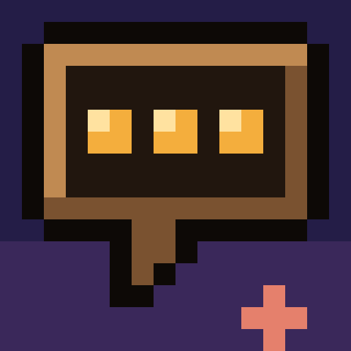
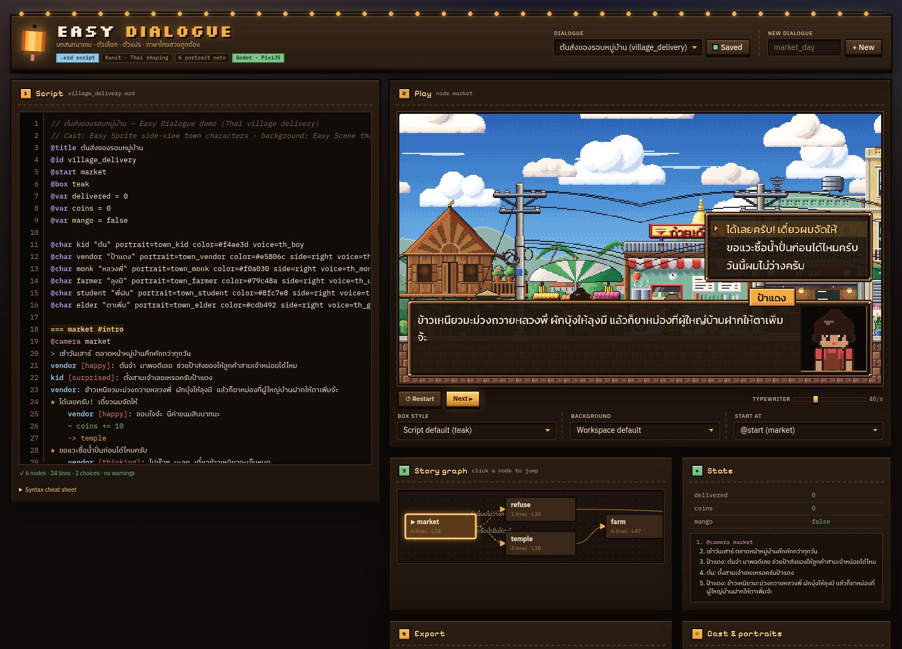
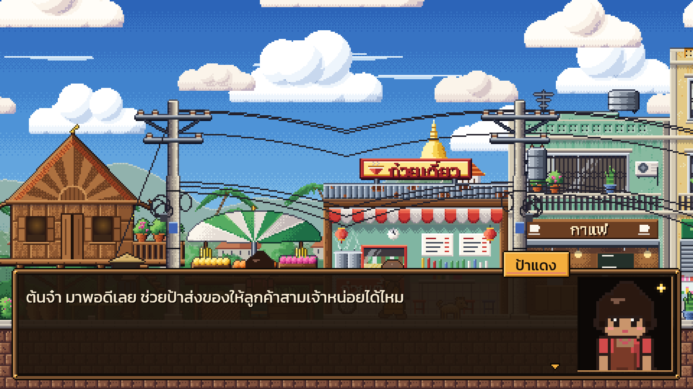
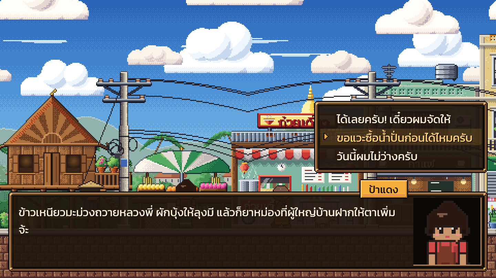
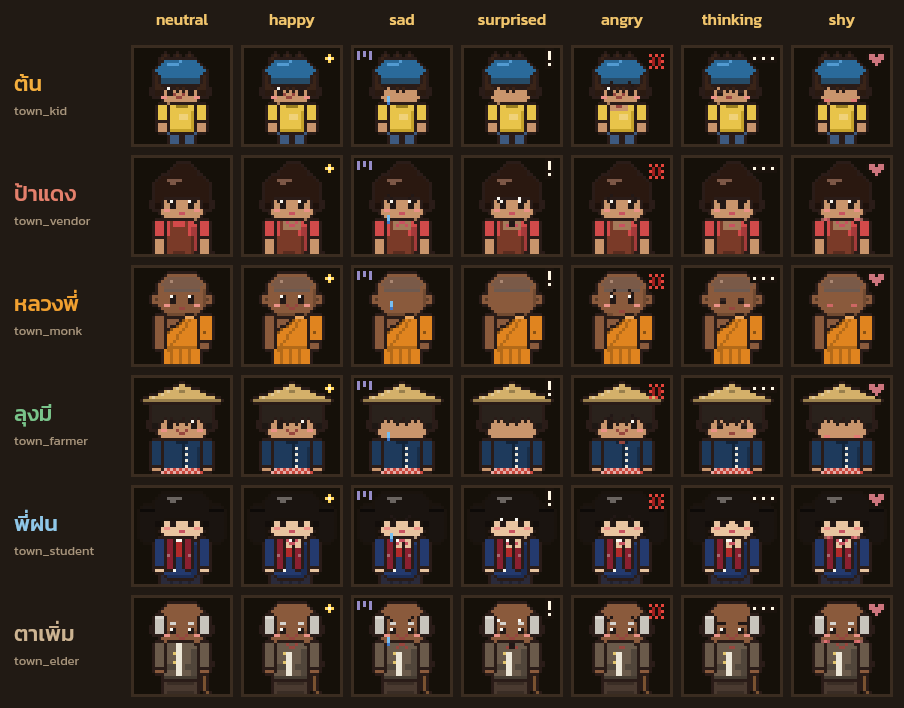
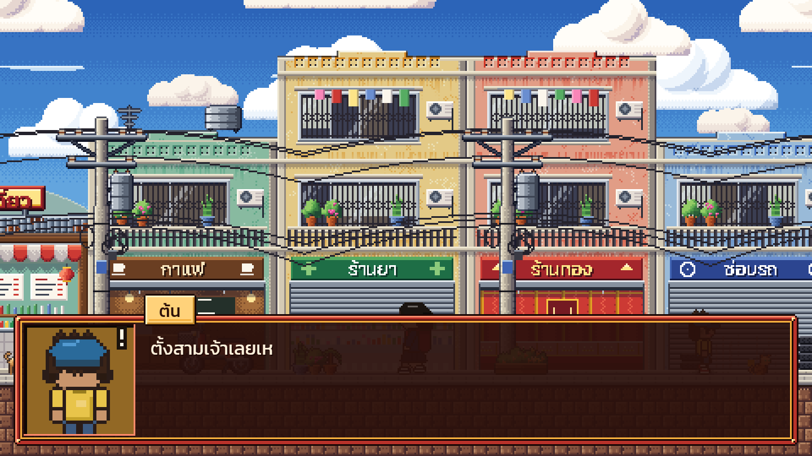

<p align="center">
  
</p>

# Easy Dialogue

**บทสนทนาเกม · ตัวเลือก · ตัวแปร · ภาษาไทยสระไม่ลอย**  
Write branching game dialogue as plain text (`.ezd`), see it play in a pixel dialogue box with Easy Sprite
portraits, and export it to **Godot 4.3+**, **PixiJS v8** or JSON — with Thai text that wraps on word
boundaries and never drops a vowel or tone mark. The third sibling of
[Easy Sprite](https://github.com/Saladin2020/easysprite) (characters) and
[Easy Scene](https://github.com/Saladin2020/easyscene) (levels).

[](LICENSE)
[](https://nodejs.org)
[](#export)
[](docs/MCP.md)

> Easy Dialogue **writes · checks · plays · renders · exports**. No AI generation in-app, and it never calls
> a TTS API — the voice export is a manifest you can feed to ElevenLabs yourself.

<p align="center">
  
</p>

<p align="center">
  
  
</p>

---

## What you get

| Script | Box | Portraits | Export |
| --- | --- | --- | --- |
| `.ezd` text: characters, nodes, choices with conditions, `if/elif/else`, variables, `{interpolation}`, events, line ids — errors with **line numbers** and "did you mean" | 9-slice pixel frames in 4 styles (teak · lantern · paper · night), name plate in the character colour, typewriter by grapheme cluster, choice list with cursor, next arrow | 32×32 crops from Easy Sprite sheets ×2, 7 emotions (generic faces re-composed with Easy Sprite where possible; lashes/elder/glasses and other non-generic faces get procedural eye/mouth variants so those features stay; plus pixel overlays) | Godot 4.3+ project (runner + `DialogueBox.tscn`), PixiJS v8 runtime + demo page, compiled JSON, voice manifest (JSON + CSV) |

* **Thai first.** Kanit (OFL) is bundled and used everywhere: Skia/HarfBuzz for PNG previews, the browser,
  Pixi and Godot. Lines wrap with `Intl.Segmenter` (ICU word-smart autowrap in Godot) so Thai needs no spaces,
  and the typewriter reveals whole clusters (`น้ำ`, `ที่`, `ผู้`) instead of floating marks.
* **One runner, three places.** The same JS runner drives the CLI, the editor, the tests and the Pixi
  export; the GDScript runner mirrors it, and a test compares their transcripts.
* **Agent friendly.** CLI with `--json`, an HTTP API and an MCP server (stdio + HTTP) with 7 tools.

<p align="center">
  
</p>

<p align="center">
  
</p>

## Quick start

```bash
npm install
npx tsx src/cli.ts init --workspace ./my-dialogue      # demo scripts, cast portraits, backgrounds
npx tsx src/cli.ts serve --workspace ./my-dialogue     # editor → http://127.0.0.1:8798/
```

Dev mode: `npm run dev` (API on 8798) + `npx vite --config web/vite.config.ts` (UI on 5175).

The editor: script with syntax highlighting and an error gutter (`Ctrl+S` saves; drafts with errors are kept but cannot be exported), live play
preview (click / Enter / Space, ↑↓ or 1-9 for choices, typewriter speed, box style, background, start node),
story graph (click a node to jump), variables + transcript, export buttons and the cast list.

## Script in 20 lines

```ezd
@title ต้นส่งของรอบหมู่บ้าน
@var coins = 0
@char kid    "ต้น"    portrait=town_kid    color=#f4ae3d voice=th_boy
@char vendor "ป้าแดง" portrait=town_vendor color=#e5806c side=right voice=th_auntie

=== market
> เช้าวันเสาร์ ตลาดหน้าหมู่บ้านคึกคัก
vendor [happy]: ต้นจ๋า ช่วยป้าส่งของหน่อยได้ไหม
* ได้เลยครับ!
    ~ coins += 10
    -> temple
* [if coins >= 5] ซื้อขนมก่อน -> END
* ไม่ว่างครับ -> END

=== temple
kid [ดีใจ]: ได้ค่าขนม {coins} บาทแล้ว
@sfx fanfare
```

Full reference: **[docs/SCRIPT_FORMAT.md](docs/SCRIPT_FORMAT.md)** (headers, statements, expressions,
diagnostics and the compiled `easydialogue/1` JSON).

## CLI

```bash
easydialogue check village_delivery            # file:line:col errors / warnings; exit 1 on errors (--strict, --json)
easydialogue play village_delivery             # interactive in the terminal
easydialogue play village_delivery --picks 0,0 --vars
easydialogue render village_delivery --choice 1 --selected 1 --out choices.png   # 1440×810 (--scale 3)
easydialogue render village_delivery --line 4 --style night --reveal 0.5 --out typing.png
easydialogue portraits --sheet path/to/hero.png --id hero       # Easy Sprite sheet (+ .json) → portraits/hero/<emotion>.png
easydialogue export village_delivery --preset all        # json | pixi | godot | voice | all
easydialogue compile village_delivery --out village.json
easydialogue list · info · portraits-list · serve [--port 8798]
```

(`npx tsx src/cli.ts …` from a checkout, `node dist/cli.js …` after `npm run build`.)

## Export

| Preset | Output (`exports/<id>-<preset>/`) |
| --- | --- |
| `json` | `<id>.dialogue.json` — compiled `easydialogue/1` |
| `pixi` | bundle JSON (doc + layout + asset paths), `easydialogue-runner.js`, `easydialogue-pixi.js` (`loadDialogue`, `DialogueBox`), frames, used portraits, Kanit, background and a playable `index.html` |
| `godot` | Godot 4.3+ project: `addons/easydialogue/` (`dialogue_runner.gd`, `dialogue_box.gd`, `dialogue_box.tscn`), demo `main.tscn`, `test_runner.gd`, 480×270 viewport, nearest filter, integer scale |
| `voice` | `<id>.voice.json` + `.voice.csv`: every line with id, speaker, character `voice=` id, emotion, text, suggested file — **manifest only** |

**PixiJS v8**

```js
import { loadDialogue, DialogueBox } from "./easydialogue-pixi.js";
const bundle = await loadDialogue(PIXI, "./village_delivery.dialogue.json");
const box = new DialogueBox(PIXI, bundle, { onEvent: (name, args) => {}, onEnd: (vars) => {} });
app.stage.addChild(box.view);
app.ticker.add((t) => box.update(t.deltaMS / 1000));
box.bindKeys(window, app.canvas);
box.start();
```

Drop `pixi.min.js` next to `index.html` to run offline; otherwise it loads PixiJS 8 from jsDelivr.

**Godot 4.3+** — open the exported folder and press F5, or copy `addons/easydialogue`, `fonts/`, `frames/`,
`portraits/` and `dialogue/` into your project, instance `dialogue_box.tscn` in a `CanvasLayer` and set
`dialogue_path`. Signals: `line_started(ev)`, `choice_made(option)`, `event_fired(name, args)`,
`dialogue_finished(vars)`. Headless check: `godot --headless --path . --script res://test_runner.gd -- picks=0,0`.

<p align="center">
  
  
</p>

## Portraits from Easy Sprite

`easydialogue portraits --sheet sheet.png` reads the front idle frame of an Easy Sprite native sheet, centres a
32×32 crop on the eyes and writes `neutral happy sad surprised angry thinking shy`. When the sheet's `.json`
has its project selections and the Easy Sprite CLI is available (`EASYDIALOGUE_EASYSPRITE_CLI`), generic faces
are re-composed (`face_smile` for happy, `face_blink` for thinking, `face_frown` / `face_surprise` / `face_wink`
when those parts exist). Non-generic faces (lashes, elder, glasses, beard…) keep their features and get
procedural per-emotion eye/mouth variants instead of a whole-face swap. Every emotion also gets a small pixel
overlay. Failed-condition choices default to hidden; `@choices grey` (or a per-choice `[grey]` / `#grey`) shows
them greyed out and unselectable. Use any other 32px+ PNGs by dropping them in `portraits/<set>/<emotion>.png`.

## MCP

`npm run mcp` (stdio) or `npm run mcp:http` (`http://127.0.0.1:8799/mcp`). Tools: `workspace_info`,
`list_dialogues`, `get_dialogue`, `write_dialogue`, `make_portraits`, `render_preview`, `export_dialogue`.
See **[docs/MCP.md](docs/MCP.md)**.

## Security

The server binds to `127.0.0.1` by default and rejects cross-origin writes and non-loopback `Host` headers.
`--host 0.0.0.0` requires the token printed at startup (or `EASYDIALOGUE_TOKEN`). API and MCP paths stay
inside the workspace plus `EASYDIALOGUE_ALLOWED_DIRS`.

## Development

```bash
npm run typecheck && npm test && npm run build && npm run smoke
GODOT=/path/to/godot npx vitest run test/godot.test.ts   # GDScript ↔ JS runner parity
npm run docs:images                                      # README images from the samples
python3 scripts/check-pixi.py exports/village_delivery-pixi   # headless Chrome: Pixi export, no console errors
python3 scripts/capture-ui.py                           # editor screenshot (server on :8798)
```

Ports: API / editor 8798 · MCP HTTP 8799 · Vite 5175.

## Credits

Kanit © The Kanit Project Authors (SIL OFL 1.1). Frames, overlays and icons are CC0. Sample cast from Easy
Sprite, backgrounds from Easy Scene. See [CREDITS.md](CREDITS.md). Code: MIT © Salahuddin Benno.
